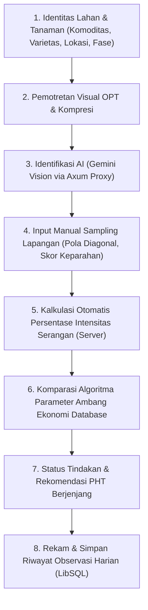

# GEMINI.md - Panduan Arsitektur & Aturan Sistem: sigap-opt

Dokumen ini adalah **Single Source of Truth (SSOT)** dan pedoman absolut pengembangan sistem **sigap-opt**. Setiap agen AI, pengembang, dan kontributor wajib mematuhi seluruh spesifikasi, batasan arsitektur, skema basis data, dan konvensi yang tercantum di bawah ini.

---

## 1. Ringkasan & Identitas Sistem

- **Nama Aplikasi**: `sigap-opt`
- **Fungsi Utama**: Mendukung penerapan sistem **Pengendalian Hama Terpadu (PHT)** melalui proses identifikasi digital berbasis kecerdasan buatan (AI Vision), pemantauan data intensitas serangan secara berkala, dan pengambilan keputusan pengendalian hama/penyakit tanaman secara presisi berdasarkan ambang ekonomi lapangan.
- **Prinsip Utama**:
  - *Data-Driven Agronomy*: Keputusan pengendalian tidak berbasis intuisi melainkan kalkulasi intensitas serangan riil berbanding ambang ekonomi.
  - *Single Binary Portability*: Seluruh backend dan frontend SPA dikemas ke dalam satu file binary executable Rust tunggal.
  - *Mobile-First & Bottom Nav SPA*: Antarmuka dirancang prioritas mobile layar sentuh dengan navigasi utama berada di bawah layar (*bottom bar*).
  - *Ultra-Clean UI*: Tampilan antarmuka sangat minim teks (minimal copywriting), berbasis metrik, visual, dan komponen bawaan Ark UI.

---

## 2. Tech Stack & Arsitektur Sistem

| Komponen | Teknologi | Keterangan |
| :--- | :--- | :--- |
| **Frontend Framework** | **SolidJS** | Reaktivitas *fine-grained* tanpa Virtual DOM overhead. Performa ultra-cepat dan footprint memori minimal. |
| **Component Primitives** | **Ark UI** (`@ark-ui/solid`) | Komponen UI unstyled, aksesibel, dan modular dari Chakra/Zag.js. Menggunakan state machine bawaan Ark. |
| **Icon System** | **Phosphor Icons** (`phosphor-solid`) | Ikon visual konsisten, kaya bobot (*regular, bold, fill, duotone*), representasi visual cepat untuk UI minim teks. |
| **Tipografi** | **DM Sans & Roboto** | Keterbacaan tinggi di lapangan (DM Sans untuk Display/Heading, Roboto untuk Data/Body). |
| **Styling & Theme** | **Tailwind CSS** | Utilitas styling modern dengan aturan palet warna ketat (Oranye, Ungu, Putih). |
| **Backend Framework** | **Rust Axum** | Web framework asinkron performa tinggi berbasis Tokio, Tower, dan Hyper. |
| **Database Engine** | **LibSQL** | Database berbasis SQLite yang mendukung in-process embedded storage lokal dan distributed sync (Turso compatible). |
| **AI Vision Engine** | **Google AI Studio (Gemini API)** | Analisis citra tanaman dan identifikasi OPT secara otomatis via Google Gemini multimodal vision. |
| **Packaging & Distribution** | **Single Binary (`rust-embed`)** | Static frontend build di-bundle langsung ke dalam binary Axum Rust saat kompilasi rilis. |
| **Container & DevOps** | **Podman CLI** | Standar runtime dan build container rootless, OCI-compliant (`podman build`, `podman run`). |

---

## 3. Desain UI/UX & Design System

### 3.1. Filosofi Minimal Copywriting & Clean UI
- **Tanpa Teks Penjelas Panjang**: Hindari narasi panjang, paragraf deskriptif, atau kalimat promosi/marketing.
- **Icon & Metric-Driven (Phosphor Icons)**: Seluruh aksi dan navigasi diutamakan berbasis ikon dari **Phosphor Icons** (`phosphor-solid`), badge status, dan angka telemetri yang presisi. Gunakan varian bobot Phosphor (*regular* untuk default, *bold*/*fill* untuk state aktif/peringatan).
- **Label Singkat**: Maksimal 1-2 kata untuk setiap label formulir dan tombol aksi (contoh: `Komoditas`, `Sampel`, `Terserang`, `Analisis`, `Simpan`, `Eksekusi`).
- **Komponen Native Ark UI**: Menggunakan struktur komponen resmi bawaan Ark UI (`<Dialog>`, `<Select>`, `<Tabs>`, `<Slider>`, `<Popover>`, `<Toast>`, `<FileUpload>`, dll.) tanpa manipulasi DOM manual di luar reaktivitas SolidJS.

### 3.2. Tata Letak Mobile-First & Navigasi Bawah ala SPA (Bottom Bar)
- **Desain Mobile-First**: Seluruh tata letak diprioritaskan untuk layar ponsel pintar (360px–430px) demi kemudahan operasional langsung di lapangan pertanian dengan satu tangan (*thumb-friendly zone*). Pada viewport desktop, antarmuka dirender dalam kontainer terpusat (*centered container* maks. `max-w-md` hingga `max-w-lg`) agar ergonomi tetap seragam.
- **Sidebar Berada di Bawah (Fixed Bottom Bar)**: Menu navigasi utama (alih-alih sidebar samping) **wajib ditempatkan di bagian bawah layar (fixed bottom)** ala mobile SPA. Dilarang menggunakan sidebar vertikal samping yang memotong ruang pandang mobile.
- **Elemen Navigasi Bawah**: Menyajikan item navigasi berbasis Phosphor Icons dengan label mikro untuk rute resmi sesuai peran RBAC pengguna:
  - *Petani*: Beranda/Dashboard, Observasi Lapangan.
  - *Super Admin*: Dashboard, Observasi, Pengguna, Ambang Ekonomi.
- **Aksi Cepat Terpusat**: Tombol Observasi Cepat dapat didesain menonjol di tengah (*elevated center action*) pada bar bawah untuk memudahkan pengambilan foto OPT secara instan.

### 3.3. Skema Warna Wajib (Strict Tri-Color Palette)
Aplikasi hanya diperbolehkan menggunakan kombinasi 3 warna inti: **Oranye**, **Ungu**, dan **Putih** (beserta gradasi netral pendukung untuk kontras teks):

| Nama Warna | Kode Hex / Tailwind Token | Peran / Penggunaan Utama |
| :--- | :--- | :--- |
| **Oranye (Orange)** | `#F97316` (`orange-500`), `#EA580C` (`orange-600`) | Aksen aksi utama (CTA), indikator bahaya/peringatan PHT, tombol eksekusi, tracker slider. |
| **Ungu (Purple)** | `#7C3AED` (`violet-600`), `#6D28D9` (`purple-700`) | Identitas brand, header navigasi, kartu AI vision, status PHT aman/terkendali. |
| **Putih (White)** | `#FFFFFF` (`white`), `#F8FAFC` (`slate-50`) | Latar belakang permukaan kartu data, modal popover, kontras data bersih. |
| **Teks & Kontras** | `#0F172A` (`slate-900`), `#475569` (`slate-600`) | Tipografi visibilitas tinggi untuk pembacaan data di lapangan dengan latar terang. |

### 3.4. Tipografi & Font Family
- **DM Sans**: Font tampilan utama (heading, nama aplikasi, tombol aksi, angka metrik KPI).
- **Roboto**: Font data & body (input formulir, label sampling kuantitatif, teks rekomendasi).

---

## 4. Struktur Halaman (HANYA 5 Halaman)

Aplikasi **DILARANG KERAS** memiliki halaman atau rute selain 5 rute berikut:

```
/
├── /login            -> Autentikasi Pengguna
├── /dashboard        -> Ringkasan & Monitoring Metrik PHT Lahan
├── /observasi        -> Alur Identifikasi AI & Kalkulasi Ambang PHT
├── /users            -> Manajemen Pengguna (Petani & Admin)
└── /ambang-ekonomi   -> Master Data & Parameter Ambang Ekonomi OPT
```

Setiap fitur tambahan (misal: detail observasi, filter riwayat, preview kamera) wajib diimplementasikan dalam bentuk **Ark UI Modal/Dialog**, **Tabs**, atau **Drawer** di dalam salah satu dari 5 halaman di atas, bukan membuat rute baru.

---

## 5. Role-Based Access Control (RBAC) Matrix

Sistem menerapkan RBAC ketat di level API Backend (Axum Middleware) dan Frontend (SolidJS Route Guards):

| Route | Petani | Super Admin | Deskripsi Izin & Akses |
| :--- | :---: | :---: | :--- |
| `/login` | **CRUD** (Auth) | **CRUD** (Auth) | Masuk, keluar, dan refresh sesi autentikasi token JWT. |
| `/dashboard` | **READ** | **CRUD** | **Petani**: Melihat grafik pemantauan, status serangan pada lahan miliknya, dan riwayat ringkas.<br>**Super Admin**: Mengakses agregasi data seluruh petani, analitik daerah, ekspor data, konfigurasi widget. |
| `/observasi` | **CRUD** | **CRUD** | **Petani & Super Admin**: Melakukan pemotretan OPT, identifikasi AI, pengisian sampel lapangan, kalkulasi otomatis, melihat rekomendasi, dan menyimpan/mengubah riwayat pengamatan. |
| `/users` | **FORBIDDEN (403)** | **CRUD** | **Petani**: Akses ditolak dan rute disembunyikan dari navigasi.<br>**Super Admin**: Mengelola akun pengguna (buat akun petani baru, reset password, ubah role, aktifkan/nonaktifkan user). |
| `/ambang-ekonomi` | **FORBIDDEN (403)** | **CRUD** | **Petani**: Akses ditolak dan rute disembunyikan dari navigasi.<br>**Super Admin**: Menambah, memperbarui, atau menghapus batas ambang ekonomi komoditas, fase tanam, persentase toleransi, dan formula rekomendasi PHT. |

---

## 6. Alur Modul `/dashboard` (Monitoring & Rekapitulasi PHT)

Alur kerja halaman `/dashboard` dimulai ketika pengguna membuka beranda utama aplikasi, di mana sistem di latar belakang akan secara otomatis menarik seluruh rekapitulasi riwayat pengamatan yang sebelumnya telah diinput melalui modul observasi. Data tersebut kemudian ditampilkan di layar dalam bentuk visualisasi grafik ringkasan yang merangkum kondisi lahan, seperti tren naik-turunnya intensitas serangan hama serta daftar organisme pengganggu yang paling sering terdeteksi pada minggu tersebut.

Selain berfungsi sebagai penampil data, sistem pada dasbor juga akan menyorot dan memberikan peringatan status bahaya untuk lahan-lahan yang tingkat kerusakannya diketahui telah melampaui batas toleransi berdasarkan sinkronisasi dengan parameter di modul ambang ekonomi. Sebagai pusat kendali, halaman ini pada akhirnya menyediakan tombol navigasi cepat yang memudahkan pengguna untuk langsung melompat ke modul observasi guna memulai pemantauan harian baru, atau mengakses modul ambang ekonomi khusus bagi Administrator.

---

## 7. Alur Modul `/observasi` (Core PHT Decision Workflow)

Modul `/observasi` adalah jantung operasional aplikasi `sigap-opt`. Alur kerja khusus untuk modul `/observasi` dimulai ketika pengguna, seperti petani atau penyuluh, mengakses menu observasi untuk memulai proses pemantauan kesehatan lahan secara langsung.



### Rincian Alur Bisnis & Teknis:
1. **Input Variabel Identitas Lahan & Tanaman**:
   - Pengguna diwajibkan menginput variabel identitas lahan dan tanaman:
     - Jenis Komoditas (Padi, Jagung, Cabai, Bawang Merah, dll.).
     - Varietas Tanaman.
     - Lokasi / Petak Lahan.
     - Fase Tumbuh Tanaman saat pengamatan dilakukan (Vegetatif / Generatif).
2. **Pemotretan Visual OPT Lapangan & Kompresi Citra**:
   - Pengguna mengambil foto wujud hama atau gejala kerusakan pada daun/organ tanaman menggunakan fitur kamera di dalam aplikasi (Ark UI MediaStream / FileUpload).
   - Citra foto dikompresi secara efisien di sisi klien sebelum dikirimkan ke server backend.
3. **Analisis AI Multimodal (Google Gemini Vision API via Server Proxy)**:
   - Berkas citra terkompresi diteruskan oleh server proxy Axum ke Google AI Studio Gemini API secara aman.
   - AI memproses gambar dan secara instan mengembalikan hasil identifikasi berupa nama organisme pengganggu tumbuhan (OPT) spesifik, nama ilmiah, dan persentase tingkat keyakinan (*confidence score*) langsung ke layar ponsel pengguna.
4. **Input Manual Observasi Lapangan (Sampling Pola Diagonal)**:
   - Pengguna mengamati sejumlah tanaman sampel secara acak di lahan (menggunakan pola diagonal standar agronomi).
   - Pengguna memasukkan variabel-variabel kuantitatif pengamatan ke dalam formulir aplikasi:
     - Jumlah total tanaman sampel yang diamati ($N$).
     - Jumlah tanaman pada tiap tingkatan skor keparahan kerusakan ($n_i$).
     - Nilai skor kerusakan tertinggi yang digunakan ($Z$).
5. **Kalkulasi Otomatis Intensitas Serangan di Server**:
   - Sistem di server Axum secara otomatis melakukan kalkulasi matematis menggunakan rumus baku PHT:
     $$\text{Intensitas Serangan: } I = \frac{\sum (n_i \times v_i)}{N \times Z} \times 100\% \quad \text{atau} \quad I = \frac{n}{N} \times 100\%$$
     *(Di mana $n_i$ = jumlah tanaman pada kategori serangan ke-$i$, $v_i$ = bobot nilai skala keparahan, $N$ = total tanaman sampel, $Z$ = bobot skala tertinggi).*
6. **Komparasi Algoritma dengan Basis Data Ambang Ekonomi**:
   - Algoritma sistem menarik parameter ambang ekonomi dari LibSQL berdasarkan kombinasi: `opt_id` + `komoditas_id` + `fase_pertumbuhan`.
   - Menghitung posisi intensitas $I$ terhadap Batas Waspada ($AW$) dan Ambang Ekonomi ($AE$).
7. **Peringatan Status Tindakan & Rekomendasi PHT Berjenjang**:
   - Apabila intensitas serangan melampaui ambang batas, aplikasi memunculkan peringatan status tindakan disertai panduan rekomendasi PHT berjenjang:
     1. **Prioritas 1 - Pengendalian Mekanis**: Pembersihan fisik, pengumpulan kelompok telur/ulat, pemasangan perangkap likat.
     2. **Prioritas 2 - Kultur Teknis**: Pengaturan tata air, sanitasi gulma inang, pergiliran tanaman, pemupukan berimbang.
     3. **Prioritas 3 - Agens Hayati**: Pelepasan musuh alami, parasitoid *Trichogramma*, cendawan entomopatogen (*Beauveria bassiana*), atau biopestisida.
     4. **Pilihan Paling Akhir - Insektisida / Pestisida Kimia Selektif**: Aplikasi bahan kimia sintetis hanya sebagai pilihan darurat terakhir dengan prinsip tepat dosis, tepat sasaran, dan tepat waktu.
8. **Penyimpanan Riwayat Observasi Harian (LibSQL Persistence)**:
   - Seluruh rincian hasil identifikasi AI, foto, variabel kuantitatif sampling, angka perhitungan intensitas, status bahaya, dan rekomendasi yang diberikan direkam dan disimpan secara permanen ke dalam tabel `observasi` LibSQL.
   - Data menjadi riwayat observasi harian yang dapat diakses kembali untuk mengevaluasi tren serangan dan efektivitas pengendalian di masa mendatang.

---

## 8. Alur Modul `/ambang-ekonomi` (Master Parameter PHT Workflow)

Alur kerja khusus untuk modul `/ambang-ekonomi` diawali dengan proses verifikasi keamanan oleh sistem untuk memastikan bahwa pengguna yang mencoba mengakses halaman tersebut memiliki peran dan hak akses sebagai Administrator. Jika pengguna tidak memiliki hak otorisasi yang sesuai, seperti petani atau penyuluh, sistem akan menolak permintaan tersebut dan memblokir akses masuk secara otomatis.

Setelah autentikasi berhasil, Administrator akan diarahkan ke halaman dasbor manajemen data master untuk mengelola, memperbarui, atau menambahkan parameter ambang ekonomi yang baru berdasarkan rujukan dari literatur atau pakar pertanian. Pada proses penambahan data tersebut, sistem akan mewajibkan Administrator untuk mengisi formulir yang berisi beberapa variabel utama, yaitu:
- **Komoditas Tanaman Prioritas**: Jenis komoditas yang dilindungi.
- **Identitas OPT**: Nama spesifik atau jenis organisme pengganggu tanaman.
- **Fase Pertumbuhan Tanaman**: Menentukan toleransi kerusakan (Vegetatif / Generatif) karena setiap fase memiliki sensitivitas berbeda.
- **Besaran Nilai Ambang & Satuan Ukur**: Nilai ambang pengendalian beserta satuan ukurnya, yang dapat berupa angka persentase (%) untuk mengukur intensitas kerusakan atau rasio jumlah ekor per sampel untuk mengukur kepadatan populasi hama.

Setelah seluruh variabel wajib selesai diinput, sistem akan memvalidasi format pengisian data dan menyimpannya secara permanen ke dalam basis data terpusat (LibSQL / SQLite). Dengan tersimpannya data master tersebut, alur pengelolaan selesai dan parameter ambang ekonomi akan terus bersiaga di dalam sistem (*back-end*) agar dapat ditarik secara otomatis sebagai standar acuan ketika modul observasi perlu membandingkan hasil hitungan intensitas serangan dari lapangan.

---

## 9. Integrasi Google AI Studio (Gemini Vision API)

### 9.1. Konfigurasi Kredensial
- **API Key**: `your-gemini-api-key-here`
- **Variabel Lingkungan (Environment Variable)**:
  ```env
  GEMINI_API_KEY=your-gemini-api-key-here
  GEMINI_MODEL=gemini-2.5-flash
  ```
- **Prinsip Keamanan**: Frontend tidak boleh memanggil Google AI Studio secara langsung. Frontend mengirim berkas gambar ke endpoint backend Axum (`/api/ai/identify`), dan backend yang mengeksekusi request ke Gemini menggunakan API Key yang tersimpan di server.

### 9.2. Kontrak Respons JSON AI Vision
Sistem backend mengirimkan prompt terstruktur dengan instruksi output murni berformat JSON tanpa blok markdown:

```json
{
  "nama_opt": "Wereng Batang Coklat",
  "nama_ilmiah": "Nilaparvata lugens",
  "kategori": "Hama",
  "bagian_terserang": "Batang",
  "confidence_score": 0.94,
  "gejala_khas": "Batang tanaman mengering dan berwarna kecokelatan (hopperburn)"
}
```

---

## 10. Skema Basis Data (LibSQL / SQLite)

```sql
CREATE TABLE IF NOT EXISTS users (
    id TEXT PRIMARY KEY,
    username TEXT UNIQUE NOT NULL,
    password_hash TEXT NOT NULL,
    full_name TEXT NOT NULL,
    role TEXT NOT NULL CHECK(role IN ('petani', 'superadmin')),
    created_at DATETIME DEFAULT CURRENT_TIMESTAMP
);

CREATE TABLE IF NOT EXISTS komoditas (
    id TEXT PRIMARY KEY,
    nama TEXT NOT NULL,
    varietas TEXT,
    created_at DATETIME DEFAULT CURRENT_TIMESTAMP
);

CREATE TABLE IF NOT EXISTS opt_katalog (
    id TEXT PRIMARY KEY,
    nama_opt TEXT NOT NULL,
    nama_ilmiah TEXT NOT NULL,
    kategori TEXT NOT NULL CHECK(kategori IN ('Hama', 'Penyakit')),
    deskripsi TEXT,
    created_at DATETIME DEFAULT CURRENT_TIMESTAMP
);

CREATE TABLE IF NOT EXISTS ambang_ekonomi (
    id TEXT PRIMARY KEY,
    komoditas_id TEXT NOT NULL REFERENCES komoditas(id) ON DELETE CASCADE,
    opt_id TEXT NOT NULL REFERENCES opt_katalog(id) ON DELETE CASCADE,
    fase_pertumbuhan TEXT NOT NULL CHECK(fase_pertumbuhan IN ('Vegetatif', 'Generatif', 'Semua Fase')),
    nilai_waspada_persen REAL NOT NULL,
    nilai_ambang_ekonomi_persen REAL NOT NULL,
    satuan TEXT DEFAULT '%',
    rekomendasi_aman TEXT NOT NULL,
    rekomendasi_waspada TEXT NOT NULL,
    rekomendasi_bahaya TEXT NOT NULL,
    updated_at DATETIME DEFAULT CURRENT_TIMESTAMP
);

CREATE TABLE IF NOT EXISTS observasi (
    id TEXT PRIMARY KEY,
    user_id TEXT NOT NULL REFERENCES users(id) ON DELETE CASCADE,
    komoditas_id TEXT NOT NULL REFERENCES komoditas(id) ON DELETE RESTRICT,
    opt_id TEXT REFERENCES opt_katalog(id) ON DELETE SET NULL,
    fase_pertumbuhan TEXT NOT NULL,
    foto_path TEXT NOT NULL,
    ai_nama_opt TEXT,
    ai_confidence REAL,
    ai_raw_json TEXT,
    total_sampel INTEGER NOT NULL,
    total_terserang INTEGER NOT NULL,
    intensitas_serangan_persen REAL NOT NULL,
    status_bahaya TEXT NOT NULL CHECK(status_bahaya IN ('AMAN', 'WASPADA', 'BAHAYA')),
    rekomendasi_pht TEXT NOT NULL,
    catatan_lapangan TEXT,
    created_at DATETIME DEFAULT CURRENT_TIMESTAMP
);

CREATE INDEX IF NOT EXISTS idx_observasi_user ON observasi(user_id);
CREATE INDEX IF NOT EXISTS idx_observasi_created ON observasi(created_at);
CREATE INDEX IF NOT EXISTS idx_ambang_lookup ON ambang_ekonomi(komoditas_id, opt_id, fase_pertumbuhan);
```

---

## 11. Arsitektur Single Binary & Deployment Podman

### 11.1. Konsep Single Binary
Aplikasi dikompilasi menjadi satu executable mandiri:
1. Kode sumber frontend SolidJS di-*build* menjadi file statis (`dist/`).
2. Kode backend Rust menggunakan crate `rust-embed` untuk menyematkan seluruh isi folder `dist/` ke dalam file biner Axum.
3. Saat dijalankan, binary Rust bertindak sebagai web server Axum yang melayani API (`/api/*`) sekaligus menyajikan aset web SPA SolidJS untuk seluruh rute browser (`/login`, `/dashboard`, `/observasi`, `/users`, `/ambang-ekonomi`).

### 11.2. Spesifikasi Containerfile (Multi-Stage Build Podman)
```dockerfile
# Stage 1: Build Frontend (SolidJS + Ark UI + Tailwind)
FROM docker.io/library/node:20-alpine AS frontend-builder
WORKDIR /app/frontend
COPY frontend/package.json frontend/pnpm-lock.yaml* ./
RUN corepack enable && corepack prepare pnpm@latest --activate && pnpm install --frozen-lockfile
COPY frontend/ ./
RUN pnpm build

# Stage 2: Build Backend & Embed Frontend Static Assets
FROM docker.io/library/rust:1.80-alpine AS backend-builder
RUN apk add --no-cache musl-dev
WORKDIR /app
COPY Cargo.toml Cargo.lock ./
COPY src/ ./src/
COPY --from=frontend-builder /app/frontend/dist ./frontend/dist
ENV RUSTFLAGS="-C target-feature=-crt-static"
RUN cargo build --release

# Stage 3: Minimal Distroless / Alpine Runtime
FROM docker.io/library/alpine:3.20 AS runner
RUN apk add --no-cache ca-certificates tzdata
WORKDIR /app
COPY --from=backend-builder /app/target/release/sigap-opt /app/sigap-opt
VOLUME /app/data
ENV DATABASE_URL="file:/app/data/sigap_opt.db" PORT=8080 APP_HOST="0.0.0.0" GEMINI_API_KEY="your-gemini-api-key-here"
EXPOSE 8080
ENTRYPOINT ["/app/sigap-opt"]
```

### 11.3. Perintah Podman CLI & Podman Compose Standar
```bash
# 1. Jalankan langsung menggunakan Podman Compose (Rekomendasi Lokal)
podman compose up -d --build

# 2. Atau menggunakan perintah Podman CLI manual
podman build -t sigap-opt:latest -f Containerfile .
podman volume create sigap-opt-data
podman run -d --name sigap-opt-instance -p 8080:8080 -v sigap-opt-data:/app/data:Z -e GEMINI_API_KEY="your-gemini-api-key-here" --restart unless-stopped localhost/sigap-opt:latest
podman logs -f sigap-opt-instance
```

---

## 12. Tata Letak Direktori Proyek

```
sigap-opt/
├── Cargo.toml                 # Konfigurasi Rust & dependensi crates
├── Cargo.lock
├── Containerfile              # Podman build file multi-stage
├── GEMINI.md                  # Dokumentasi & Aturan Utama (Dokumen ini)
├── README.md
├── migrations/                # Skrip DDL LibSQL
│   └── 0001_initial_pht.sql
├── src/                       # Backend Rust Axum
│   ├── main.rs                # Entrypoint & inisialisasi server
│   ├── config.rs              # Pengaturan env & kredensial
│   ├── db.rs                  # Koneksi & pool LibSQL
│   ├── models/                # Definisi struct: user.rs, observasi.rs, ambang.rs
│   ├── handlers/              # Controller: auth.rs, observasi.rs, ai.rs, ambang.rs, users.rs
│   ├── middleware/            # JWT & RBAC guards (auth_guard.rs)
│   └── static_embed.rs        # rust-embed handler untuk SolidJS SPA
└── frontend/                  # Frontend SolidJS SPA
    ├── package.json, vite.config.ts, tailwind.config.js, tsconfig.json
    └── src/
        ├── App.tsx            # Setup Router & Layout Container
        ├── index.css          # Tailwind base & Ark UI styles
        ├── components/
        │   ├── ui/            # Button.tsx, Dialog.tsx, Select.tsx, Slider.tsx, Card.tsx
        │   └── layout/        # Header.tsx, BottomNav.tsx (Fixed Bottom Nav)
        ├── pages/             # 5 Rute: Login, Dashboard, Observasi, Users, AmbangEkonomi
        ├── services/          # API fetcher & client auth state
        └── lib/               # Kalkulator rumus intensitas PHT
```

---

## 13. Pedoman Pengkodean & Aturan Penegakan

1. **Integritas Rute**: Jangan pernah menambahkan rute di luar `/login`, `/dashboard`, `/observasi`, `/users`, dan `/ambang-ekonomi`.
2. **Kepatuhan Desain**: Hindari teks panjang. Gunakan elemen UI standar Ark UI, ikonografi Phosphor Icons (`phosphor-solid`), dan kombinasi warna wajib Oranye, Ungu, dan Putih.
3. **Keamanan RBAC**: Setiap endpoint API mutlak diverifikasi dengan token JWT dan pengecekan role pengguna (`petani` vs `superadmin`). Petani tidak boleh memiliki akses write ke master ambang ekonomi atau membaca data pengguna lain.
4. **Validasi Perhitungan PHT**: Perhitungan intensitas serangan harus konsisten baik di sisi klien SolidJS (untuk respon kilat real-time) maupun di sisi backend Rust Axum (sebagai validator sebelum data disimpan ke LibSQL).
5. **Format Respons AI**: Endpoint AI backend wajib memvalidasi keluaran Gemini API ke struct kuat Rust (`serde_json`) sebelum dikirimkan ke frontend untuk mencegah eror parsing data visual di gawai lapangan.
6. **Desain Mobile-First & Navigasi Bawah**: Struktur tata letak aplikasi wajib memprioritaskan viewport mobile (*thumb-friendly* di lapangan). Seluruh menu navigasi rute utama ditempatkan pada bar bawah (*bottom bar* ala SPA), dan dilarang menggunakan sidebar vertikal samping konvensional.
